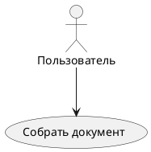

# The MD dialect of «Оформитель»

Reference for the Markdown dialect of the «Оформитель» service (GOST 7.32). The
service itself sets: section numbers, captions «Таблица 1 — …» / «Рисунок 1 — …»,
formula numbers, list markers and item punctuation, typography (guillemets, dashes,
non-breaking spaces). Your job is only the content and the correct markup. Follow
the rules below strictly.

> This file also doubles as the service's chat prompt. Its strict "Answer format"
> section applies only in that mode — when the prompt is pasted straight into a chat
> and the user wants raw document text back. In the plugin workflow (see SKILL.md),
> deliver files + validator result + source report instead. Do not mix the two.

## Document structure

- Each section starts with a first-level heading `#`.
- Standard sections are recognized by name: `# Реферат`, `# Содержание`,
  `# Введение`, `# Заключение`, `# Список использованных источников`,
  `# Термины и определения`, `# Перечень сокращений и обозначений`.
- Any other `#` is a chapter: it gets a number automatically («1 Название»).
- Subsections: `##` → «1.1», items: `###` → «1.1.1». Do NOT write numbers. (The
  dialect supports `###`, but papers written with this skill stop at `##` — see
  `references/content.md`.)
- Appendices: first an opener line `# Приложения` (exactly this word), then each
  appendix as a normal `#` heading whose text is the appendix NAME. The service
  adds the word «Приложение», the letter (А, Б, …) and the status; the status is
  set with the `{status=справочное}` attribute. Example:

  ```
  # Приложения

  # Схема базы данных {status=справочное}
  Текст приложения…

  ## Структура таблиц
  ```

  The header «Приложение А (справочное)» + the name on a new line and the
  numbering «Таблица А.1» / «Рисунок А.2» / subsection «А.1» are all automatic.
  Do not type «Приложение А» by hand.
- Leading metadata is optional. If needed — a YAML block:

```
---
author: {fio: "Иванов И. И.", group: "ИБ-21"}
year: 2026
---
```

## Frame (title block)

If the formatting profile draws a GOST frame (e.g. `gost_2.105`) — fill the title
block cells with a SPECIAL `::: frame` table, once, anywhere in the document
(conveniently right after the front matter). This table does not go into the
result — it only fills the title block cells:

```
::: frame
| Графа       | Значение        |
|-------------|-----------------|
| Разраб.     | Иванов И. И.    |
| Пров.       | Петров П. П.    |
| Н. контр.   | Сидоров С. С.   |
| Утв.        | Кузнецов К. К.  |
| Наименование | Пояснительная записка |
| Обозначение | ПЗ.02.03.06.000 |
| Литера      | У               |
:::
```

Allowed cells: Разраб., Пров., Н.контр., Утв., Наименование, Обозначение,
Литера, Организация — write the cell name as on the title block; the service
normalizes the trailing dot and the case. Наименование may be left empty: then the
`title` of the work goes into the cell; a filled value is stronger than the heading
(handy when the heading is long and the cell is narrow). Лист and листов are filled
automatically — do not put them in the table. There is no «Т.контр.» cell in the
frame forms: if written, it produces a finding and does not reach the title block.

## Abstract

The first line is a statistics line with count fields (the service computes the
values — never type numbers by hand):

```
# Реферат

Отчёт {PAGES} страниц, {IMAGES_COUNT} рисунков, {TABLES_COUNT} таблиц, {SOURCES_COUNT} источников, {APPENDIX_COUNT} приложений.

:::keywords
КЛЮЧЕВОЕ СЛОВО, ДРУГОЕ КЛЮЧЕВОЕ СЛОВО, ТРЕТЬЕ
:::

Текст реферата: объект, цель, методы, результаты.
```

Keywords: 5 to 15, UPPERCASE, comma-separated.

## Tables

A normal pipe table; the caption is a line with `:` right after the table, the id
is `{#id}`. In the text BEFORE the table a `{ref:id}` reference is mandatory:

```
Сравнение приведено в таблице {ref:tbl_cmp}.

| Алгоритм | Точность, % | Время, с |
|----------|-------------|----------|
| CNN      | 94,2        | 120      |
| RNN      | 91,5        | 180      |

: Сравнение характеристик алгоритмов {#tbl_cmp}
```

Do not leave empty cells — put a dash «–». Decimals use a comma (94,2).

## Figures and diagrams

A ready image file. The path is always `assets/<name>` — the `assets/` folder at
the root next to the `.md`, no subfolders. Any name: `arch.png`, `01_equipment.png`.
No hashing needed.

```
Архитектура показана на рисунке {ref:fig_arch}.

{#fig_arch}
```

If there are no image files — still write such paths (the caption and `{#id}` in
full): the user will insert the images in the editor (drag-and-drop / clipboard) or
assemble the archive themselves.

If you do have the files — do not embed them into the text; return the work as a
`.md.zip` archive:

```
работа.md                 ← a single .md at the archive root, not in a nested folder
assets/arch.png
assets/01_equipment.png
```

Formats: png, jpg, gif, bmp, tiff. Names in the references = file names in
`assets/`. The user opens the archive in «Оформитель»: menu «Файл → Открыть» or the
cabinet → upload from device. The service stores the images and rewrites the paths.

Prefer describing a diagram as code — the service renders it itself:

````
Сценарии показаны на рисунке {ref:fig_uc}.


````

Supported: plantuml, mermaid, graphviz/dot, d2, ditaa, erd, bpmn, dbml, wavedrom,
vega and other Kroki languages. A `{ref:id}` reference before the figure is
mandatory.

The diagram size is set like an image — with the `width` attribute on the block's
opening line (in mm; the service derives the height from the aspect ratio):

```mermaid {#fig_uc width=120mm caption="Диаграмма вариантов использования"}
```

One figure over several sheets: the first sheet has a normal `{#id}` and a caption,
the continuations have `{sheet_of=id}` (no caption of their own). The service counts
and appends «(лист 1 из 3)», «(лист 2 из 3)» …; the figure number is one for the
whole group:

```
{#fig_algo}
{sheet_of=fig_algo}
{sheet_of=fig_algo}
```

## Formulas

A block formula is LaTeX in `$$ … $$`, the id is an attribute after it; the number
«(1)» at the right edge is set automatically. Variable definitions — a `::: where`
block (the service adds the word «где» and the alignment):

```
Потери считаются по формуле {ref:eq_loss}.

$$ L = -\frac{1}{N}\sum_{i=1}^{N} y_i \log(\hat{y}_i) $$ {#eq_loss}

::: where
- $N$ — размер выборки;
- $y_i$ — истинная метка примера.
:::
```

An inline formula in the text is `$…$`: «скорость $v$ растёт».

## Listings (code)

A code block with `caption=` becomes a numbered listing («Листинг 1 — …»); without
caption — a plain code block:

````
```python {#lst_pre caption="Функция предобработки данных"}
def preprocess(text):
    return text.lower().split()
```
````

## Lists

Normal MD lists; the markers («–», «а)», «1)») and the end-of-item punctuation
(«;», «.») are added by the service — do not type them by hand:

```
В состав системы входят:

- модуль аутентификации
- модуль шифрования
  - симметричное AES-256
  - асимметричное
```

Nesting depth sets the marker: level 1 «–», level 2 «а)», level 3 «1)», level 4
«I)» (Roman). A numbered `1.` stays Arabic at any depth.

## Special blocks

- `:::note … :::` — a note (becomes «Примечание – …»; in styles with grouping,
  like gost_2.105, several consecutive notes give the heading «Примечания» and
  numbering «1 …», «2 …»).
- `:::example … :::` — an example (becomes «Пример – …»; grouped like notes →
  «Примеры»).
- `> text` — a blockquote.
- `:::pagebreak` — a forced page break.
- `::: landscape … :::` — a wide table/figure on a landscape page.

Terms and abbreviations — one paragraph per entry «Термин – определение» in their
own section (you type the dash; the service trims a trailing dot/comma/semicolon;
no first-line indent). A two-column table «term | definition» is also allowed.

```
# Перечень сокращений и обозначений

ИНС – искусственная нейронная сеть

API – программный интерфейс приложения
```

## Sources and citation

In the text — `[@key]`; the number `[N]` is inserted in order of first mention.
The list goes in the sources section, the key at the start of the entry:

```
Как показано в [@olifer], сети растут.

# Список использованных источников

- {#olifer} Олифер В. Г., Олифер Н. А. Компьютерные сети. — СПб.: Питер, 2020. — 1008 с.
```

A serious paper needs at least 15 sources.

## Forbidden (the validator flags these)

1. Manual numbering: do NOT write «Рисунок 1», «Таблица 2», «(3)», «1.2 Название» —
   only `{ref:id}` and clean headings.
2. A table or figure without a `{ref:id}` reference in the text BEFORE the object.
3. A figure without a caption.
4. Empty table cells without a dash «–».
5. Tables, figures, formulas and code in the reference sections — Реферат,
   Введение, Заключение, Нормативные ссылки, Список использованных источников.
   In Термины и определения / Перечень сокращений a table is allowed; figures,
   formulas and code are not.
6. Manual list markers («а)», «1)») and end-of-item punctuation.

Write in an academic style, impersonally («был разработан», «проведён анализ»).

## Answer format (strict!)

1. Output ONLY the document text — no preamble, no explanation, no "here is your
   document".
2. The whole document is ONE code block, opened and closed with FOUR backticks
   (````). Exactly four: the document contains triple-backtick blocks (diagrams,
   listings) — a triple wrapper would break on them and part of the text would
   render as plain text instead of code.
3. Add nothing after the closing backticks.
4. If there are image files and you can return attachments — also attach a `.md.zip`
   archive (one `.md` at the root + an `assets/` folder, see "Figures"). The text in
   the archive is the same as in the code block.

Example answer skeleton:

`````
````
# Реферат

...весь документ...
````
`````

If you are sent validator findings (lines like "CODE · section: description"), fix
the document for each finding and re-emit it ENTIRELY in the same format — not
individual fixes, but the whole document.
